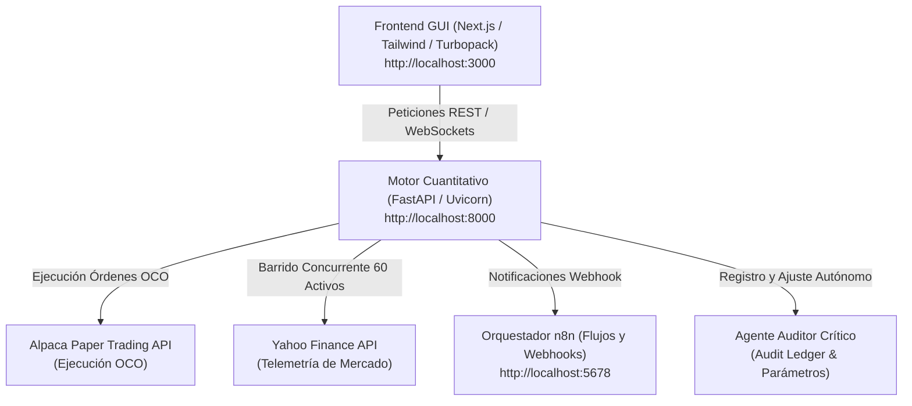

# Sistema de Trading Cuantitativo Agéntico Multi-Agente (Trading Multiagent)

Sistema integral de trading cuantitativo y supervisión agéntica diseñado para combinar la precisión matemática del análisis cuantitativo (Oscilador Estocástico, DMI/ADX, EMA/SMA, ATR) con la supervisión de agentes de inteligencia artificial y control humano (*Human-in-the-Loop*).

---

## 🌟 Características Principales

* **Radar Cuantitativo en Vivo (60 Activos):**
  * Monitoreo distribuido y concurrente de 4 clústeres especializados:
    * `TECH_GROWTH`: Grandes tecnológicas y semiconductores (NVDA, AAPL, MSFT, GOOGL, META, etc.).
    * `FINANCE_CONSUMER`: Gigantes financieros y consumo masivo (V, MA, JPM, WFC, KO, PEP, COST, WMT, etc.).
    * `HEALTH_INDUSTRIAL`: Farma, salud, energía e industria pesada (ABBV, LLY, PFE, MRK, UNH, XOM, CVX, CAT, GE, etc.).
    * `HIGH_BETA_EXPANSION`: Activos de alta beta, SaaS y crecimiento exponencial (COIN, HOOD, CRWD, PANW, NET, etc.).
* **Gestión Estricta del Riesgo Institucional:**
  * Riesgo máximo acotado al **1.0%** del equity por operación.
  * Stop Loss dinámico a **$1.5 \times \text{ATR}(14)$** bajo el precio de entrada.
  * Take Profit automático a **$3.0 \times \text{ATR}(14)$** (Ratio Riesgo/Beneficio $1:2$).
  * Cortafuegos automático (*Circuit Breaker*) al alcanzar una pérdida de sesión acumulada del **4%**.
  * Filtro estricto de comisiones del bróker ($\le 10\%$ del beneficio bruto esperado).
* **Macro Regime Gatekeeper:**
  * Supervisión autónoma en tiempo real de los índices directores (SPY y QQQ) y su posición respecto al VWAP intradía.
  * Evaluación de la amplitud interna de mercado (% alcistas vs. cuchillos cayendo).
  * Veto automático de nuevas posiciones largas (*Risk-Off Lockdown*) durante episodios de liquidación sistémica.
* **Escudo Anti-Falling Knife:**
  * Detección algorítmica de caídas verticales o capitulaciones intradía para evitar comprar "cuchillos cayendo".
* **Ejecución Bracket OCO con Alpaca Paper Trading:**
  * Enrutamiento de órdenes directas con órdenes límite comercializables (*Marketable Limit*), SL y TP vinculados en el bróker.
* **Panel de Control Gráfico Integral (Next.js GUI):**
  * Gráficos interactivos de velas (*Lightweight Charts*) con visualización de medias (EMA 20, SMA 50, SMA 200) y líneas de SL/TP.
  * Botones de aprobación en 1 clic (*Human-in-the-Loop*) con tesis diagnóstica.
  * Libro de órdenes, estado de cartera y auditoría independiente.

---

## 🏛️ Arquitectura del Sistema



---

## 🚀 Puesta en Marcha Rápida

### Requisitos Previos
* [Docker Desktop](https://www.docker.com/products/docker-desktop/) instalado y en ejecución.
* [Node.js](https://nodejs.org/) (versión 20 o superior).
* Cuenta en [Alpaca Markets](https://alpaca.markets/) (Paper Trading con coste 0€).

### 1. Clonar el Repositorio
```bash
git clone https://github.com/eroncerom/trading_multiagent.git
cd trading_multiagent
```

### 2. Configurar Variables de Entorno
Copia la plantilla de ejemplo y añade tus credenciales:
```bash
cp .env.example .env
```
Edita `.env` con tus claves:
* `ALPACA_API_KEY` y `ALPACA_SECRET_KEY`
* `GEMINI_API_KEY` (opcional para análisis cualitativo agéntico)

### 3. Arranque Automático (Windows)
Haz doble clic en el archivo:
```bat
iniciar_sistema.bat
```
El script levantará los contenedores de Docker, el servidor de desarrollo web y abrirá automáticamente tu navegador en **http://localhost:3000**.

### 4. Arranque Manual

**Backend y Servicios (Docker):**
```bash
docker compose up -d
```

**Frontend (Next.js):**
```bash
cd frontend
npm install
npm run dev
```

---

## 📊 Endpoints Clave del Backend (FastAPI)

| Endpoint | Método | Descripción |
| :--- | :---: | :--- |
| `/health` | `GET` | Estado del motor, equidad de cartera y conexión con Alpaca |
| `/scanner/opportunities` | `GET` | Lista de oportunidades vivas y telemetría de los 60 activos |
| `/scanner/scan-now` | `POST` | Ejecuta un barrido inmediato de todo el universo de mercado |
| `/scanner/start` | `POST` | Inicia el escaneo autónomo periódico (Manual o Full Auto) |
| `/scanner/stop` | `POST` | Detiene el escaneo y dispara la auditoría de sesión |
| `/scanner/approve/{ticker}` | `POST` | Aprobación con 1 clic para transmitir la orden OCO a Alpaca |
| `/market/candles/{ticker}` | `GET` | Histórico OHLCV de velas para el gráfico interactivo |
| `/docs` | `GET` | Documentación Swagger interactiva |

---

## 🛡️ Licencia

Distribuido bajo la licencia MIT. Consulta el archivo `LICENSE` para más detalles.
